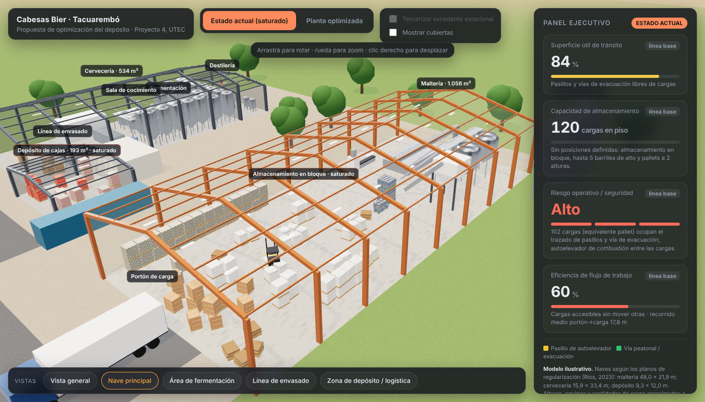
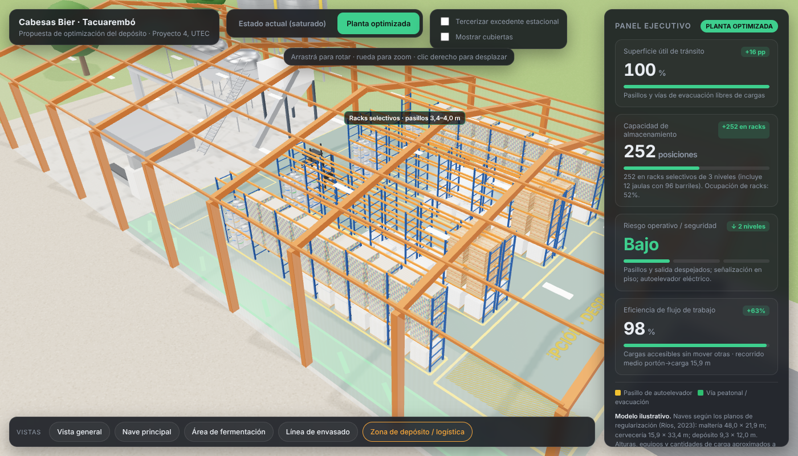

# Cabesas Bier · Visor 3D de optimización del depósito

Visor web 3D interactivo que compara el **estado actual** del almacenamiento en la planta de Cabesas Bier (Tacuarembó, Uruguay) con una **propuesta de depósito reorganizado**. Forma parte del Proyecto 4 de Ingeniería en Logística (UTEC, sede Rivera, 2026).

**Ver en línea:** https://gabrielbengoechea.github.io/cabesas-bier/

| Estado actual | Planta optimizada |
|---|---|
|  |  |

## Qué muestra

- **Estado actual (saturado):** pallets de latas en bloque a dos alturas, barriles en columnas de cinco, bolsones y pallets de bolsas dispersos, cajas junto al portón y el depósito de cajas lleno, según las fotos de la visita técnica.
- **Planta optimizada:** racks selectivos de tres niveles con pasillos de 3,4 a 4,0 m, barriles en pallets jaula, piso epoxi, líneas de pasillo (amarillo) y vía peatonal de evacuación (verde), zona de recepción y despacho y autoelevador eléctrico.
- **Tercerizar excedente estacional:** opción que carga parte del stock en un camión hacia un operador logístico.
- **Panel ejecutivo:** superficie de tránsito libre, capacidad de almacenamiento, riesgo operativo y accesibilidad de las cargas. Los valores **se calculan sobre la geometría del modelo** (grilla de 0,2 m y recorrido del autoelevador desde el portón); no son mediciones de planta.

## Uso

- Botones superiores: alternar entre *Estado actual* y *Planta optimizada*.
- Vistas predefinidas: vista general, nave principal, área de fermentación, línea de envasado y zona de depósito.
- Mouse: arrastrar para rotar, rueda para zoom, clic derecho para desplazar.

Es un único archivo (`index.html`) con Three.js 0.160 cargado desde CDN, por lo que necesita conexión a internet. Para verlo localmente basta con abrirlo en el navegador.

## Fuentes y supuestos

- Dimensiones de las naves según los planos de regularización (Ríos, 2023) y la planta general de la fábrica: maltería 48,0 × 21,9 m; cervecería 15,9 × 33,4 m; depósito 9,3 × 12,0 m; destilería 15,3 × 6,0 m.
- Distribución de equipos de la cervecería según la planta general; equipos de la maltería, alturas de las naves y cantidades de carga aproximados a partir de las fotos de la visita del 26/10/2026 y de la entrevista con la empresa.
- Modelo ilustrativo con fines académicos. No reproduce marcas ni logotipos.

## Autores

Pilar González · Paola Pacheco · Rahiana Silveira · Francisco Zagia — Ingeniería en Logística, UTEC.
